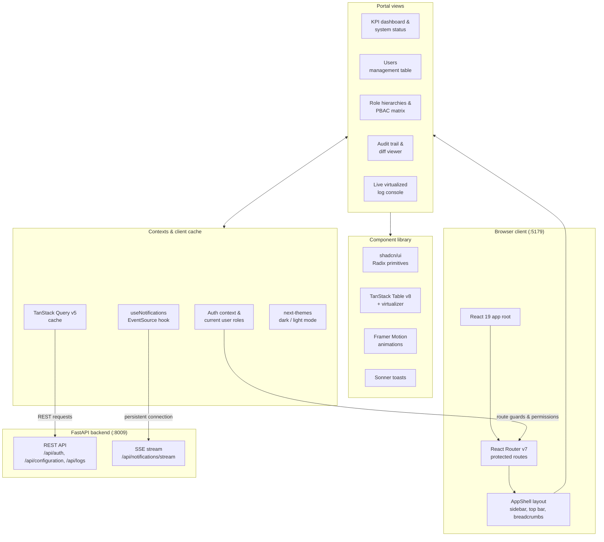

# Social Media Compliance Dashboard Frontend

Social Media Compliance web portal for ZenaTech. Built with **React 19**, **TypeScript**, **Vite 8**, **Tailwind CSS v4**, and **shadcn/ui**. Features a responsive AppShell layout, Microsoft Entra ID authentication, RBAC management views, audit log inspectors, and real-time SSE telemetry.

---

## System Architecture Diagram



---

## Technologies & System Specifications

| Category | Technology | Description |
| :--- | :--- | :--- |
| **Framework & Build** | [React 19](https://react.dev/), [Vite 8](https://vitejs.dev/) | Lightning fast ES module builds, pinned port `5179` |
| **Language** | [TypeScript](https://www.typescriptlang.org/) | Strict typings for models, API responses, and prop contracts |
| **Styling & Theme** | [Tailwind CSS v4](https://tailwindcss.com/), `@shadcn/react`, `next-themes` | Modern utility CSS with custom CSS variables and dark mode support |
| **Data Fetching & Cache**| [TanStack React Query v5](https://tanstack.com/query) | Stale-time caching, automatic retries, and optimistic mutations |
| **Tables & Virtualization** | [TanStack React Table v8](https://tanstack.com/table), [TanStack Virtual](https://tanstack.com/virtual) | High-performance virtualized grids capable of rendering thousands of audit records |
| **Drag & Drop** | `@hello-pangea/dnd` | Smooth drag-and-drop lists and ordering controls |
| **Routing & Protection** | [React Router v7](https://reactrouter.com/) | Protected route guards checking PBAC navigation codes and action permissions |
| **Animations & UI Primitives** | [Framer Motion](https://www.framer.com/motion/), `sonner`, `vaul`, Radix UI | Toasts, animated drawers, accessible dialogs, and popovers |
| **Excel & Export** | `exceljs`, `date-fns`, `clsx`, `tailwind-merge` | Client-side spreadsheet generation and export utilities |

---

## Core Features & Workflows

1. **Role-Based Access Control (RBAC & PBAC)**:
   - User assignment, group action matrix (View, Create, Edit, Delete), and route method enforcement.
2. **Microsoft Entra ID SSO**:
   - Single sign-on with token exchange and automatic access status evaluation (`/pending-access`).
3. **AppShell Architecture**:
   - Collapsible permission-filtered sidebar, live connection health indicator, dynamic breadcrumbs, and notification tray.
4. **Real-Time Notification Center**:
   - Zero-overhead SSE listener with automatic reconnection, heartbeat pings, and toast alerts.
5. **Observability & Log Inspection**:
   - Filterable audit trail with JSON payload diff viewer and live application console logs.

---

<!-- project-structure:start -->
## Project Structure

```text
src/
  assets/                   # Images and icons
  components/               # Reusable UI, one folder per feature
    AppShell/               # Layout chrome: sidebar, top bar, navigation, notifications
    common/                 # Shared by several pages: error boundary, loading screen, route guards
    dashboard/              # Dashboard widgets (creator dashboard, agenda, header)
    submissions/            # Submission review widgets: preview, sentiment, scores, captions, hashtags, approvals, Canva import
    ui/                     # shadcn/ui primitives (button, dialog, ...); don't put feature code here
    video/                  # Video upload queue drawer and platform icons
  context/                  # React context providers
  hooks/                    # Custom React hooks
  lib/                      # App-wide helpers: auth context, env, storage, utils
  pages/                    # One folder per feature/route group
    Auth/                   # Login and pending-access screens
    Compliance/             # Content screener, video scanner, compliance rulebook and messaging context
    Configurations/         # Users, roles, permissions, approval paths and OAuth integrations
    ContentCalendar/        # Content calendar and publishing drafts
    Dashboard/              # Home dashboard
    Logs/                   # Audit and system logs
    Performance/            # Post performance metrics
    SocialMedia/            # Connected social profiles, reach and published feeds
    Submissions/            # Submission list, new submission and submission detail/review
  services/                 # API calls: apiClient + one <feature>Service.ts per backend area
  types/                    # TypeScript types, one file per feature
  App.tsx                   # Web routes (lazy-loaded pages)
  main.tsx                  # Web entry: providers and router
```

### Where new code goes

* **New page:** `src/pages/<Feature>/`. Pages that belong together share a folder; a `.native.tsx` variant sits next to its web file.
* **Components:** used by one feature go in `src/components/<Feature>/`; used by several go in `src/components/common/`. `src/components/ui/` is only for shadcn primitives.
* **New API calls** go in `src/services/<feature>Service.ts` through `apiClient`, not `fetch` inside components (some older pages still do this; move those calls when you touch them). Types go in `src/types/<feature>.ts`.
* **Don't add loose files** to `src/pages/` or `src/components/`.
* **When you move a file,** update every import to it (and the imports inside it), then run `npm run build` (`tsc -b && vite build`).
<!-- project-structure:end -->

---

## Getting Started

### 1. Install Dependencies
```bash
npm install
```

### 2. Environment Variables (.env)
```env
# Backend API Base URL (FastAPI running on port 8009)
VITE_API_BASE_URL=http://localhost:8009
```

### 3. Run Development Server
```bash
npm run dev
```
Open application at `http://localhost:5179`.

### 4. Build for Production
```bash
npm run build
```

### 5. Lint
```bash
npm run lint
```
